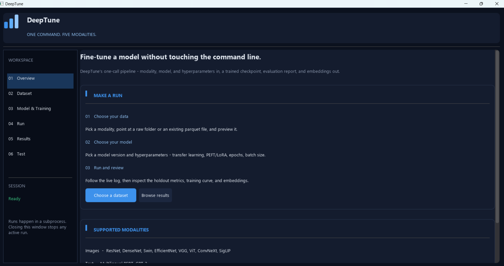
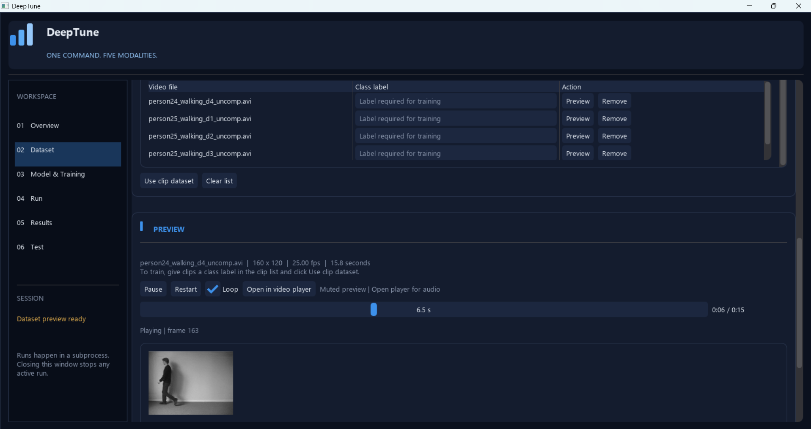
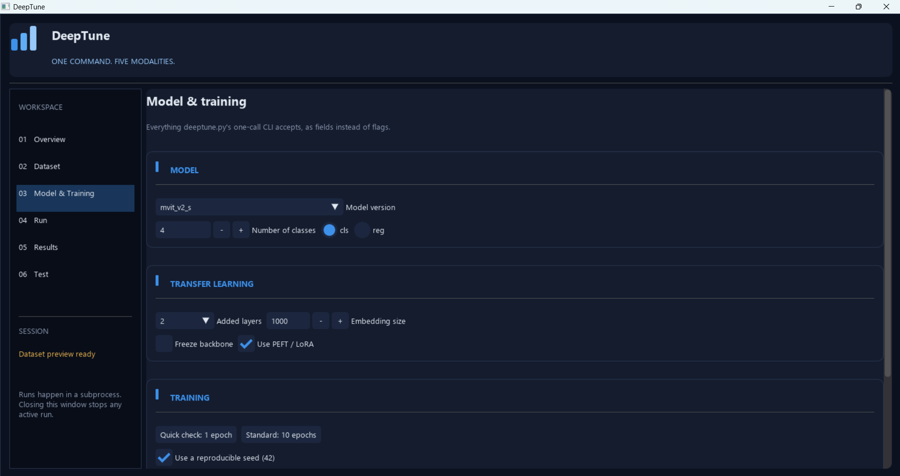

.. _getstarted:

Getting Started
===============

**DeepTune** offers two distinct interfaces for users to interact with the library: a command-line interface (CLI) and a graphical user interface (GUI). Both interfaces are compatible and mostly provide access to the same functionalities (unless specified otherwise).

1. Graphical User Interface (GUI)
---------------------------------

You may start the GUI by executing the following command in your terminal:

.. code-block:: console

    (.deeptune) $ python.exe desktop/app.py

The **Dataset** tab in the GUI allows you to explore and manage your dataset. You can browse and inspect individual images and videos directly within the interface, provided they are in supported raw formats. Additionally, you can preview or remove individual files as needed.

By accessing the **Model & Training** tab, you can select a model and configure its hyperparameters for training. The GUI provides a user-friendly interface to adjust various settings, including the model decision, tuning option, learning rate, batch size, number of epochs, and more.

In case a trained model that has been saved in the results directory is available, you can load it into the GUI for further evaluation and analysis. The **Evaluation** tab allows you to assess the model's performance on your dataset.

2. Command Line Interface (CLI)
---------------------------------

In case you prefer to use the command line interface, you can execute the following command to train a model:

.. code-block:: console

    (.deeptune) $ python -m deeptune --modality <model_name> --model <model_name> --df <dataset_path>

Each task (Image Classification & Regression, Sentiment Analysis, Clip-Level Action Classification, ...) has its own set of supported models and specific parameters that must be set in order to exeucte DeepTune properly. You can find the list of supported models with their corresponding parameters in the respective task section.

.. note::

    The CLI ``python -m deeptune`` command provides access to the same functionalities as the GUI, allowing you to train, evaluate, and analyze models directly from the command line. The coordinate regression and image reconstruction tasks are currently only available through their specific respective CLI commands. 