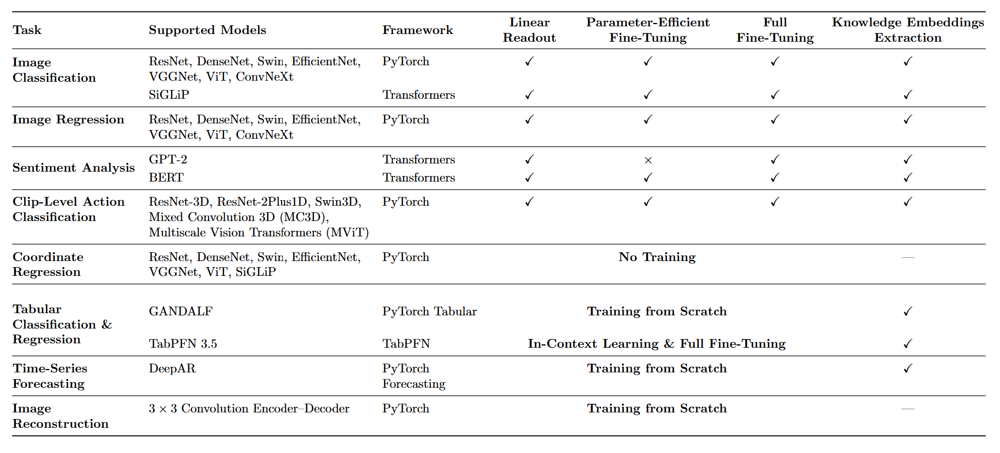

Welcome to Deeptune's documentation!
====================================

**DeepTune** is a comprehensive, automated deep learning toolkit supporting computer vision, natural language processing, video analysis, tabular data, and time series. It provides state-of-the-art algorithms and ready-to-use CLI and GUI interface, enabling users to exploit machine learning workflows across diverse applications, including medical imaging, natural language understanding, and action classification.

Check out the :doc:`guides/install` section for further information, including how to install the library.

GitHub repository can be accessed through the following link: https://github.com/moayadeldin/deeptune

.. note::

   This project is under active development.

Main Features
-------------

- **Unified Pipeline**: An automated framework supporting multiple tasks across different domains.
- **Multimodal Support**: Supports image, text, video, tabular, and time-series datasets.
- **Extensive Model Support**: Supports a wide range of models for +40 state-of-the-art deep learning models for vision, NLP, tabular, time-series, and video tasks.
- **Flexible Training Paradigms**: Supports multiple training and fine-tuning options, including end-to-end training, transfer learning, linear readout, and parameter-efficient fine-tuning (PEFT) with hyperparameter tuning, including projection-layer configuration.
- **User-Friendly Interface**: Provides both command-line interface (CLI) and graphical user interface (GUI) for ease of use.

`DeepTune` Supported Tasks
--------------------------

.. toctree::
   :maxdepth: 2
   :caption: User Guide

   guides/install
   guides/getstarted

.. toctree::
   :maxdepth: 1
   :caption: Image Classification & Regression

   tasks/imageclassreg
   tasks/imageworkflow
   configurations/imageconfig

.. toctree::
   :maxdepth: 1
   :caption: Text Classification

   tasks/textsentiment
   tasks/textworkflow
   configurations/textconfig
.. toctree::
   :maxdepth: 1
   :caption: Clip-Level Action Classification

   tasks/videoclass
   tasks/videoworkflow
   configurations/videoconfig

.. toctree::
   :maxdepth: 1
   :caption: Tabular Classification & Regression

   tasks/tabularclassreg
   tasks/tabularworkflow
   configurations/tabularconfig

.. toctree::
   :maxdepth: 1
   :caption: Coordinate Regression

   tasks/coordinateregression
   tasks/coordinateregressionworkflow
   configurations/coordinate_regression_config

.. toctree::
   :maxdepth: 1
   :caption: Time Series Forecasting

   tasks/timeseries
   tasks/timeseriesworkflow
   configurations/timeseriesconfig

.. toctree::
   :maxdepth: 1
   :caption: Image Reconstruction
   
   tasks/autoencoder
   tasks/autoencoderworkflow
   configurations/autoencoder_config

Acknowledgements
----------------
This software package was developed as part of collaborative research in the Medical Imaging Bioinformatics lab under the supervision of Jacob Levman at St. Francis Xavier Univeristy, Nova Scotia, Canada.

Citation
--------
If you find **DeepTune** useful in your research, support us with a star 💫 on the GitHub repo.

If you make use of **DeepTune**, please cite the repository as follows:

.. code-block:: bibtex

   @software{DeepTune,
   author  = {Moayadeldin Hussain, Ahmed Saad, John Kendall, Youssoff Mahfouz, Yazan Hamad, Xuchen Guo, and Jacob Levman},
   title   = {DeepTune: Cutting-edge Tool automating state-of-the-art deep learning models for cross-modal applications},
   year = {2026},
   url = {https://github.com/moayadeldin/deeptune},
   }
