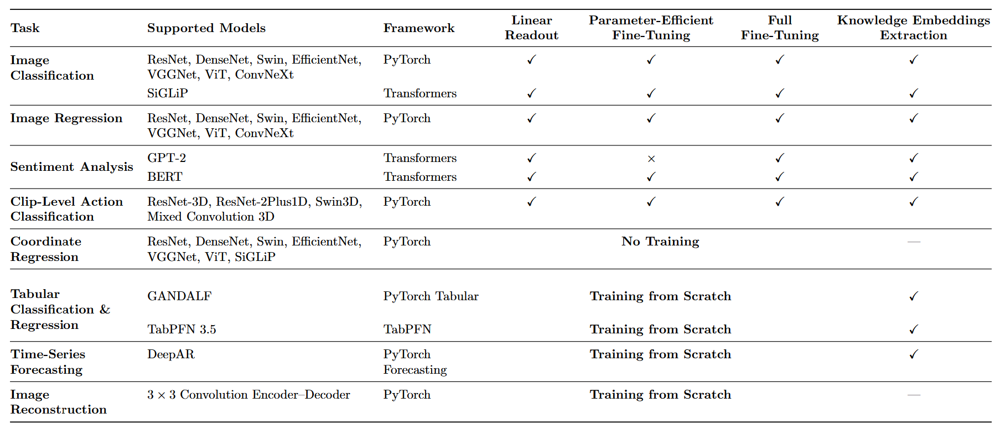

Welcome to Deeptune's documentation!
====================================

**DeepTune** is a full compatible tool package to automate Computer Vision, Natural Language Processing, Tabular, Time Series, using state-of-the-art deep learning algorithms for multimodal applications on image, text, tabular, time series, and video datasets. The library is designed for use in different applied machine learning domains, including but not limited to medical imaging, natural language understanding, action classification, and time series analysis, providing users with powerful, ready-to-use both CLI and GUI-supporting tool that unlock the full potential of their case studies through a fully-automated workflow.

Check out the :doc:`guides/install` section for further information, including how to install the library.

GitHub repository can be accessed through the following link: https://github.com/moayadeldin/deeptune

.. note::

   This project is under active development.

Main Features
-------------

- **Unified Pipeline**: An automated framework supporting multiple tasks across different domains.
- **Multimodal Support**: Supports image, text, video, tabular, and time-series datasets.
- **Extensive Model Support**: Supports a wide range of support for +40 state-of-the-art deep learning models for vision, NLP, tabular, time-series, and video tasks.
- **Flexible Training Paradigms**: Supports multiple training and fine-tuning options, including end-to-end training, transfer learning, linear readout, and parameter-efficient fine-tuning (PEFT) with hyperparameter tuning, including projection-layer configuration.
- **User-Friendly Interface**: Provides both command-line interface (CLI) and graphical user interface (GUI) for ease of use.

`DeepTune` Supported Tasks
--------------------------

Contents
--------

.. toctree::
   :maxdepth: 2
   :caption: User Guide

   guides/install
   guides/getstarted

.. toctree::
   :maxdepth: 1
   :caption: Image Classification & Regression

   tasks/imageclassreg
   tasks/imageworkflow
   configurations/imageconfig

.. toctree::
   :maxdepth: 1
   :caption: Text Classification

   tasks/textsentiment
   tasks/textworkflow
   configurations/textconfig

Acknowledgements
----------------
This software package was developed as part of collaborative research in the Medical Imaging Bioinformatics lab under the supervision of Jacob Levman at St. Francis Xavier Univeristy, Nova Scotia, Canada.

Citation
--------
If you find **DeepTune** useful in your research, support us with a star 💫 on the GitHub repo.

If you make use of **DeepTune**, please cite the repository as follows:

.. code-block:: bibtex

   @software{DeepTune,
   author  = {Moayadeldin Hussain, Ahmed Saad, John Kendall, Youssoff Mahfouz, Yazan Hamad, Xuchen Guo, and Jacob Levman},
   title   = {DeepTune: Cutting-edge Tool automating state-of-the-art deep learning models for cross-modal applications},
   year = {2026},
   url = {https://github.com/moayadeldin/deeptune},
   }
