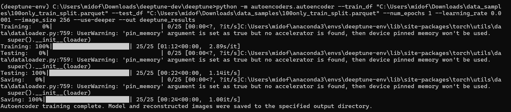
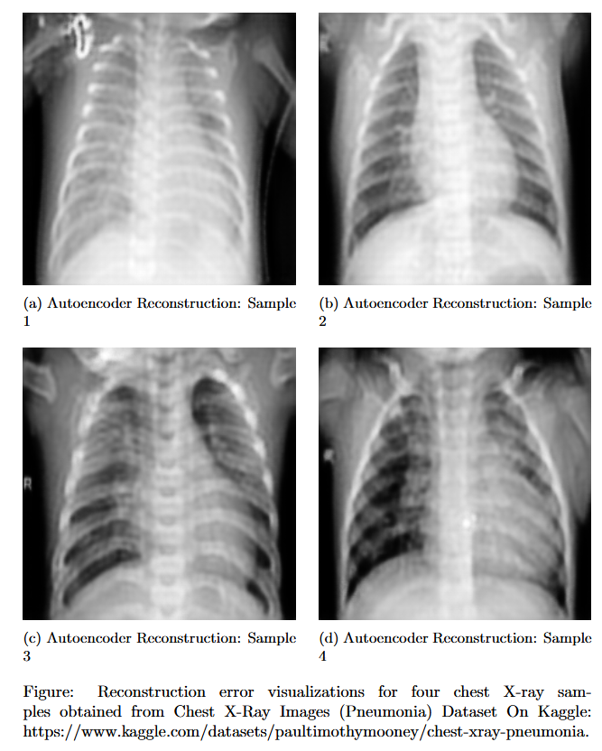

.. _autoencoder.rst:

Image Reconstruction with Autoencoders
---------------------------------------

Image reconstruction is a fundamental task in computer vision that involves generating a new image that closely resembles the original input image. Autoencoders, a type of neural network architecture, are commonly used for this purpose. They consist of an encoder that compresses the input image into a lower-dimensional representation and a decoder that reconstructs the image from this representation. **DeepTune** provides support for basic autoencoder architecture enabling image reconstruction tasks.

Running Image Reconstruction through DeepTune
~~~~~~~~~~~~~~~~~~~~~~~~~~~~~~~~~~~~~~~~~~~~~~~

**DeepTune** autoencoder architecture follows an encoder-decoder structure designed to extract and reconstruct hierarchical features. The process begins with a Gaussan blur to the input. The encoder consists of three successive stages, each stage utilizes a 3 by 3 convolutions (or a 5 by 5 in the case of the deeper autoencoder) → Group Normalization → SiLU functon, with a stride of 2 for doubling the feature channels and halving the spatial dimensions. The decoder mirrors the encoder and the model is projecting the feature maps back to the original image space dimensions.

For more information on the Group normalization and SiLU function, please refer to the following resources: `Group Normalization <https://wandb.ai/wandb_fc/GroupNorm/reports/Group-Normalization-in-Pytorch-With-Examples---VmlldzoxMzU0MzMy>`_ and `SiLU Function <https://docs.pytorch.org/docs/stable/generated/torch.nn.SiLU.html>`_ 

In order to run the image reconstruction task through the CLI, the following command can be used:

.. code-block:: console

    (.deeptune) $ python -m deeptune \
        --train_df <train_df_path> \
        --test_df <test_df_path> \
        --num_epochs <num_epochs> \
        --num_epochs <num_epochs> \
        --learning_rate <learning_rate> \
        --out <output_directory> \
        --image_size <image_size> \ //only for autoencoder tasks
        --model_weights <model_weights_path> \ // in case of reproducing a previous experiment, the model weights can be provided to continue training or for evaluation.
        --if-grayscale \ //only for autoencoder tasks
        --use-deeper \ //only for autoencoder tasks

For a detailed information on the configuration parameters and execution options for autoencoder image reconstruction task, please refer to the :doc:`../configurations/autoencoder_config` section.

