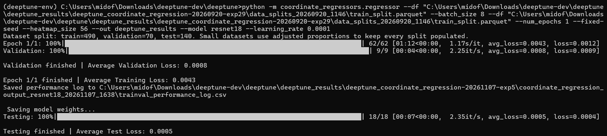

.. _coordinateregression:

Coordinate Regression
======================

Coordinate regression is a computer vision task that involves predicting the coordinates of the center of an object in an image. It is commonly used in applications such as object tracking, pose estimation, and robotics, where accurate localization of objects is crucial for decision-making and control.

.. note::
    The coordinate regression task is currently in development and is yet to be heavily tested in **DeepTune**, and it is not supported in the current GUI version. The following information provides an overview of the task and its configuration parameters. Note that the implementation may be subject to change.

Running Coordinate Regression Tasks through the DeepTune CLI
~~~~~~~~~~~~~~~~~~~~~~~~~~~~~~~~~~~~~~~~~~~~~~~~~~~~~~~~~~~~~

**DeepTune** supports the same image regression models as the image classification task, with the exception of the SiGLip model, which is not supported for the regression tasks.

- `ResNet <https://docs.pytorch.org/vision/main/models/resnet.html>`_ (PyTorch). The model versions supported are: 'resnet18', 'resnet34', 'resnet50', 'resnet101', or 'resnet152'
- `DenseNet <https://docs.pytorch.org/vision/main/models/densenet.html>`_ (PyTorch). The model versions supported are: 'densenet121', 'densenet161', 'densenet169', or 'densenet201'
- `EfficientNet <https://docs.pytorch.org/vision/main/models/efficientnet.html>`_ (PyTorch). The model versions supported are: 'efficientnet_b0', 'efficientnet_b1', 'efficientnet_b2', 'efficientnet_b3', 'efficientnet_b4', 'efficientnet_b5', 'efficientnet_b6', or 'efficientnet_b7'.
- `Swin Trasnformer <https://docs.pytorch.org/vision/main/models/swin_transformer.html>`_ (PyTorch) The model versions supported are: 'swin_t', 'swin_s', or 'swin_b'.
- `Vision Transformer (ViT) <https://docs.pytorch.org/vision/main/models/vit.html>`_ (PyTorch) The model versions supported are: 'vit_b_16', 'vit_b_32', 'vit_l_16', 'vit_l_32', or 'vit_h_14'.
- `VGGNet <https://docs.pytorch.org/vision/main/models/vgg.html>`_ (PyTorch). The model versions supported are: 'vgg11', 'vgg13', 'vgg16', or 'vgg19'.
- `ConvNeXt <https://docs.pytorch.org/vision/main/models/convnext.html>`_ (PyTorch). The model versions supported are: 'convnext_tiny', 'convnext_small', 'convnext_base', or 'convnext_large'.
- `Sigmoid Loss for Language Image Pre-Training (SiGLip) <https://huggingface.co/docs/transformers/en/model_doc/siglip>`_ (HuggingFace Transformers). The only supported version is 'siglip_so400m_patch14_384', which is called 'siglip' in the CLI.

.. code-block:: console
    
    # --heatmap_size <heatmap_size> is only required with coordinate regression tasks
    (.deeptune) $ python -m coordinate_regressors.regressor \
    --df <dataset_path> \
    --batch_size <batch_size> \
    --num_epochs <num_epochs> \
    --learning_rate <learning_rate> \
    --heatmap_size <heatmap_size> \
    --model <model_name> \
    --out <output_directory> \
    --fixed-seed \

After conducting a successful experiment of **DeepTune** for coordinate regression, the results will be saved in the specified output directory. The results include the dataset splits, trained model, and the train/val/evalauation metrics.

For a detailed information on the coordinate regression configuration parameters and execution options for image classification and regression tasks, please refer to the :doc:`../configurations/coordinate_regression_config` section.

