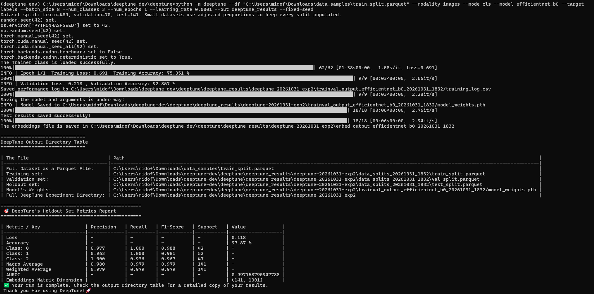
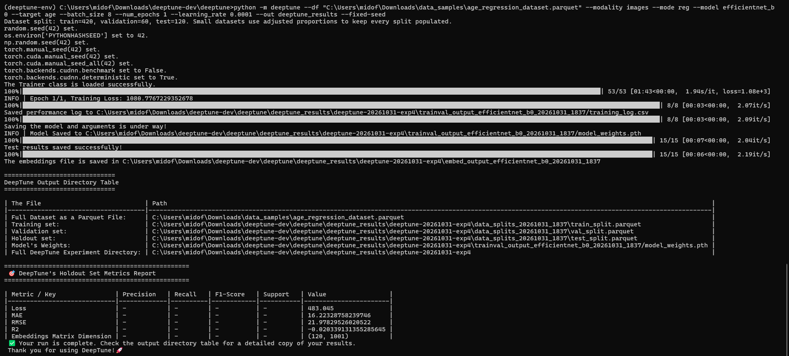

.. _imageclassreg.rst:

Image Classification & Regression
===================================

Image classification and regression are fundamental tasks in computer vision, where the goal is to assign a label or a continuous value to an input image based on its content. **DeepTune** provides a comprehensive framework for training, evaluating, and knowledge extraction of models for these tasks, supporting a wide range of state-of-the-art architectures and training paradigms.

Running Image Classification Tasks through the CLI
~~~~~~~~~~~~~~~~~~~~~~~~~~~~~~~~~~~~~~~~~~~~~~~~~~

**DeepTune** supports the following image classification models:

- `ResNet <https://docs.pytorch.org/vision/main/models/resnet.html>`_ (PyTorch). The model versions supported are: 'resnet18', 'resnet34', 'resnet50', 'resnet101', or 'resnet152'
- `DenseNet <https://docs.pytorch.org/vision/main/models/densenet.html>`_ (PyTorch). The model versions supported are: 'densenet121', 'densenet161', 'densenet169', or 'densenet201'
- `EfficientNet <https://docs.pytorch.org/vision/main/models/efficientnet.html>`_ (PyTorch). The model versions supported are: 'efficientnet_b0', 'efficientnet_b1', 'efficientnet_b2', 'efficientnet_b3', 'efficientnet_b4', 'efficientnet_b5', 'efficientnet_b6', or 'efficientnet_b7'.
- `Swin Trasnformer <https://docs.pytorch.org/vision/main/models/swin_transformer.html>`_ (PyTorch) The model versions supported are: 'swin_t', 'swin_s', or 'swin_b'.
- `Vision Transformer (ViT) <https://docs.pytorch.org/vision/main/models/vit.html>`_ (PyTorch) The model versions supported are: 'vit_b_16', 'vit_b_32', 'vit_l_16', 'vit_l_32', or 'vit_h_14'.
- `VGGNet <https://docs.pytorch.org/vision/main/models/vgg.html>`_ (PyTorch). The model versions supported are: 'vgg11', 'vgg13', 'vgg16', or 'vgg19'.
- `ConvNeXt <https://docs.pytorch.org/vision/main/models/convnext.html>`_ (PyTorch). The model versions supported are: 'convnext_tiny', 'convnext_small', 'convnext_base', or 'convnext_large'.
- `Sigmoid Loss for Language Image Pre-Training (SiGLip) <https://huggingface.co/docs/transformers/en/model_doc/siglip>`_ (HuggingFace Transformers). The only supported version is 'siglip_so400m_patch14_384', which is called 'siglip' in the CLI.

.. code-block:: console

    (.deeptune) $ python -m deeptune \
        --modality image \
        --mode cls \
        --model <model_version> \
        --df <dataset_path> \
        --target <target_column_name> \
        --batch_size <batch_size> \
        --num_classes <num_classes> \
        --num_epochs <num_epochs> \
        --learning_rate <learning_rate> \
        --grouper <grouper_column_name> \ // only for grouped cross-validation
        --out <output_directory> \
        --fixed-seed \
        --use-peft \
        --freeze-backbone \
        --raw-data \

After conducting a successfull experiment of **DeepTune** for image classification, the results will be saved in the specified output directory. The results include the dataset splits, trained model, training logs, evaluation metrics, and the knowledge embeddings extracted from the repsective test split. A summary of the experiment will be printed in the terminal, including the best model checkpoint, the evaluation metrics, and the path to the output directory as follows:

Running Image Regression Tasks through the CLI
~~~~~~~~~~~~~~~~~~~~~~~~~~~~~~~~~~~~~~~~~~~~~~

**DeepTune** supports all the same image regression models as the image classification task, with the exception of the SiGLip model, which is not supported for regression tasks.

.. code-block:: console

    (.deeptune) $ python -m deeptune \
        --modality image \
        --mode reg \
        --model <model_version> \
        --df <dataset_path> \
        --target <target_column_name> \
        --batch_size <batch_size> \
        --num_epochs <num_epochs> \
        --learning_rate <learning_rate> \
        --grouper <grouper_column_name> \ // only for grouped cross-validation
        --out <output_directory> \
        --fixed-seed \
        --use-peft \
        --freeze-backbone \
        --raw-data \

Similar to the image classification task, after conducting a successful experiment of **DeepTune** for image regression, the results will be saved in the specified output directory and shown as follows:

For a detailed information on the configuration parameters and execution options for image classification and regression tasks, please refer to the :doc:`../configurations/imageconfig` section.