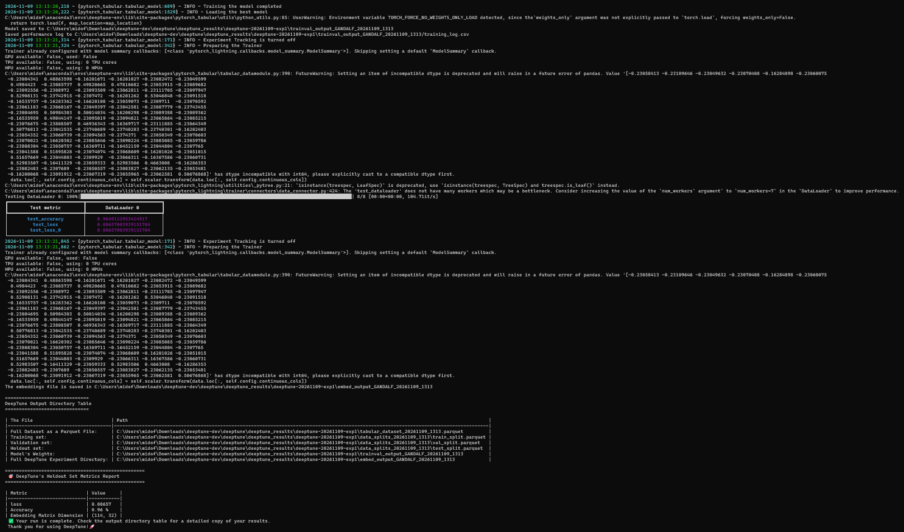
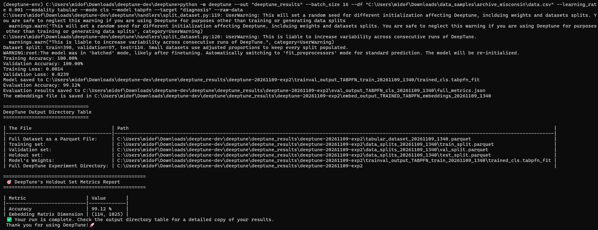

.. _tabularclassreg.rst:

Tabular Classification & Regression
===================================

Tabular classification and regression are fundamental tasks in machine learning, where the goal is to predict a categorical label or a continuous value based on structured tabular data. **DeepTune** provides a comprehensive framework for training, evaluating, and knowledge extraction of models for these tasks, supporting a wide range of state-of-the-art architectures and training paradigms.

Running Tabular Models Tasks through Deeptune
~~~~~~~~~~~~~~~~~~~~~~~~~~~~~~~~~~~~~~~~~~~~~

**DeepTune** supports the following tabular models:

- `Gated Adaptive Network for Deep Automated Learning of Features (GANDALF) <https://pytorch-tabular.readthedocs.io/en/latest/models/#gated-adaptive-network-for-deep-automated-learning-of-features-gandalf>`_ (PyTorch Tabular). The only supported version is 'gandalf'.

- `TabPFN3.5 <https://docs.priorlabs.ai/models#tabpfn-3-5-family>`_ (TabPFN3.5). The only supported version is 'tabpfn3.5'.

For the tabular classification/regression task using Gandalf, the following command can be used to run the experiment through the CLI:

.. code-block:: console

    (.deeptune) $ python -m deeptune \
        --modality tabular \
        --type <classification_or_regression> \
        --model gandalf \
        --df <dataset_path> \
        --target <target_column_name> \
        --continuous_cols <continuous_column_names> \ // only for GANDALF
        --categorical_cols <categorical_column_names> \ // only for GANDALF
        --batch_size <batch_size> \
        --num_epochs <num_epochs> \
        --learning_rate <learning_rate> \
        --gflu_stages <int> \ // only for GANDALF
        --out <output_directory> \
        --fixed-seed \

After conducting a successfull experiment of **DeepTune** for tabular tasks, the results will be saved in the specified output directory. The results include the dataset splits, trained model, training logs, evaluation metrics, and the knowledge embeddings extracted from the repsective test split. A summary of the experiment will be printed in the terminal, including the best model checkpoint, the evaluation metrics, and the path to the output directory as follows:

For the tabular classification/regression task using TabPFN3.5, the following command can be used to run the experiment through the CLI:

.. code-block:: console

    (.deeptune) $ python -m deeptune \
        --modality tabular \
        --mode <cls_or_reg> \
        --model tabpfn \
        --df <dataset_path> \
        --target <target_column_name> \
        --batch_size <batch_size> \
        --num_epochs <num_epochs> \
        --learning_rate <learning_rate> \
        --out <output_directory> \
        --finetuning-mode \
        --fixed-seed \

After conducting a successfull experiment of **DeepTune** for tabular tasks, the results will be saved in the specified output directory. The results include the dataset splits, trained model, training logs, evaluation metrics, and the knowledge embeddings extracted from the repsective test split. A summary of the experiment will be printed in the terminal, including the best model checkpoint, the evaluation metrics, and the path to the output directory as follows:

For a detailed information on the configuration parameters and execution options for tabular classification and regression tasks, please refer to the :doc:`../configurations/tabularconfig` section.