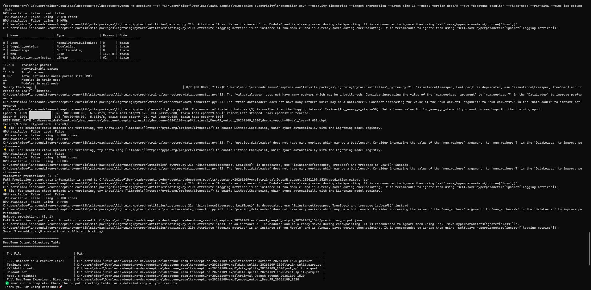

.. _timeseries.rst:

Time Series Forecasting
=======================

Time series forecasting is a critical task in machine learning, where the objective is to predict future values based on historical data. **DeepTune** offers a robust framework for training, evaluating, and extracting knowledge from models designed for time series forecasting, supporting a variety of state-of-the-art architectures and training paradigms.

Running Time Series Forecasting Tasks through DeepTune
~~~~~~~~~~~~~~~~~~~~~~~~~~~~~~~~~~~~~~~~~~~~~~~~~~~~~~~

`deepAR <https://pytorch-forecasting.readthedocs.io/en/stable/tutorials/deepar.html>`_ (Deep Autoregressive Recurrent Neural Network) is a powerful model for time series forecasting. The only supported version is 'deepar'.

.. note::
    The `deepAR` model in **DeepTune** is yet to be heavily tested and validated, especially on the effectiveness of the embeddings extraction feature. Users are encouraged to report any issues or provide feedback to help improve the implementation.

For the time-series task using deepAR, the following command can be used to run the experiment through the CLI:

.. code-block:: console

    (.deeptune) $ python -m deeptune \
        --modality timeseries \
        --model_version deepAR \
        --df <dataset_path> \
        --target <target_column_name> \
        --time_idx_column <time_index_column_name> \
        --fixed-seed

For a detailed information on the configuration parameters and execution options for tabular classification and regression tasks, please refer to the :doc:`../configurations/timeseriesconfig` section.
