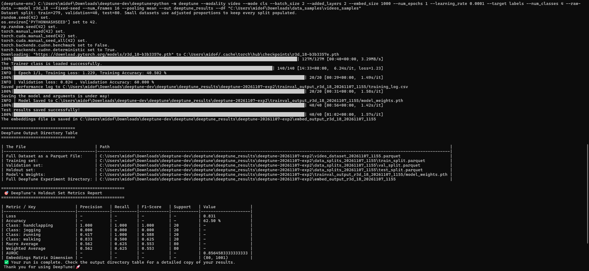

.. _videoclass.rst:

Clip-Level Action Classification
================================

Clip-Level Action Classification is a computer vision task that involves determining the action or activity being performed in a video clip. It is commonly used to analyze video content, such as sports events, surveillance footage, and AI user-generated videos, to understand human behavior, detect specific actions, and improve video content recommendations.

Running Clip-Level Action Classification Tasks through Deeptune
~~~~~~~~~~~~~~~~~~~~~~~~~~~~~~~~~~~~~~~~~~~~~~~~~~~~~~~~~~~~~~~

**DeepTune** supports the following video analysis classification models:

- `ResNet3D <https://docs.pytorch.org/vision/main/models/generated/torchvision.models.video.r3d_18.html>`_ (PyTorch). The model versions supported is: 'r3d_18'.

- `ResNet2Plus1D <https://docs.pytorch.org/vision/main/models/generated/torchvision.models.video.r2plus1d_18.html>`_ (PyTorch). The model versions supported is: 'r2plus1d_18'.

- `Mixed Convolution 3D <https://docs.pytorch.org/vision/main/models/generated/torchvision.models.video.mc3_18.html>`_ (PyTorch). The model versions supported is: 'mc3_18'.

- `Swin3D Transformer <https://docs.pytorch.org/vision/main/models/generated/torchvision.models.video.swin3d_t.html>`_ (PyTorch). The model versions supported are: Swin3D_T_Weights, Swin3D_S_Weights, Swin3D_B_Weights.

- `Multiscale Vision Transformer (MViT) <https://docs.pytorch.org/vision/main/models/generated/torchvision.models.video.mvit_v2_s.html>`_ (PyTorch). The model versions supported is: 'mvit_v2_s'.

.. code-block:: console

    (.deeptune) $ python -m deeptune \
        --modality video \
        --mode cls \
        --model <model_version> \
        --df <dataset_path> \
        --target <target_column_name> \
        --batch_size <batch_size> \
        --num_classes <num_classes> \
        --num_epochs <num_epochs> \
        --learning_rate <learning_rate> \
        --num_frames <num_frames> \ // only for video models that support frame sampling
        --pooling <pooling_method> \ // only for video models that support pooling. DeepTune supports 'mean' and 'attention' pooling methods.
        --out <output_directory> \
        --fixed-seed \
        --use-peft \
        --freeze-backbone \
        --raw-data \

After conducting a successfull experiment of **DeepTune** for video classification, the results will be saved in the specified output directory. The results include the dataset splits, trained model, training logs, evaluation metrics, and the knowledge embeddings extracted from the repsective test split. A summary of the experiment will be printed in the terminal, including the best model checkpoint, the evaluation metrics, and the path to the output directory as follows:

For a detailed information on the configuration parameters and execution options for video classification and regression tasks, please refer to the :doc:`../configurations/videoconfig` section.